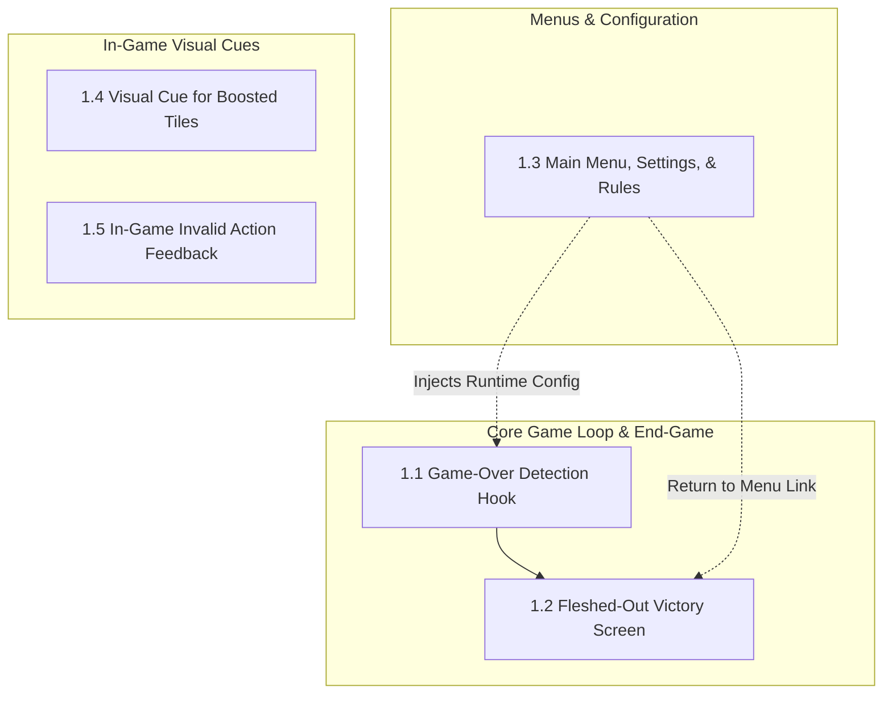

# TacTile — Development Roadmap

This document outlines the development trajectory for **TacTile**, organized into two distinct phases in accordance with project priorities:
- **Phase 1: Required University Deliverables & Bug Fixes** (Primary focus: stability, completing required core gameplay loops, user interfaces, settings validation, and deliverables).
- **Phase 2: Standalone Mobile Expansion** (Long-term vision: touch controls, UI responsiveness, mobile optimization, and AI opponents).

---

## 1. Phase 1: Required University Deliverables

All items in this section are **strictly required** for the completion of the university class deliverable. They are not optional quality-of-life improvements or speculative future ideas.



---

### 1.1 Game-Over State Detection Hook (Required)
- **Current State (*Verified Fact*):** [GameState.cs#L57-L65](file:///C:/Users/oldha/OneDrive/Documents/CST-410/TacTile/Assets/Scripts/Game/GameState.cs#L57-L65) defines `IsGameOver`:
  ```csharp
  public bool IsGameOver =>
      GetEmptySpaces().Count == 0 ||
      (GetPlayerTiles(PlayerId.Player1).Count == 0 && GetPlayerTiles(PlayerId.Player2).Count == 0);
  ```
  However, `IsGameOver` is never called or checked by [GameDriver.cs](file:///C:/Users/oldha/OneDrive/Documents/CST-410/TacTile/Assets/Scripts/Game/GameDriver.cs). When all 25 spaces are filled, the game halts with `(No legal actions available.)` logged to the console, and the match hangs indefinitely.
- **Expected Behavior:** Following every placement and combat resolution (or within `GameDriver.AdvanceAutomaticPhases()`), the game checks `state.IsGameOver`. If true, the game transitions into a terminal `GameOver` state, prevents any further tile selection or placement, and triggers the Victory Screen.
- **Completion Criteria:**
  1. The game reliably detects when all 25 spaces are filled or no playable tiles remain.
  2. Input processing cleanly halts upon match completion.
  3. The victory presentation flow is automatically invoked.
- **Dependencies:** None (foundational logic hook).
- **Relevant Scripts:** [GameState.cs](file:///C:/Users/oldha/OneDrive/Documents/CST-410/TacTile/Assets/Scripts/Game/GameState.cs), [GameDriver.cs](file:///C:/Users/oldha/OneDrive/Documents/CST-410/TacTile/Assets/Scripts/Game/GameDriver.cs), [TurnStateMachine.cs](file:///C:/Users/oldha/OneDrive/Documents/CST-410/TacTile/Assets/Scripts/Game/TurnStateMachine.cs).
- **Testing Requirements:** Play through a complete match until all 25 spaces are occupied. Verify in the Unity console and UI that game-over triggers immediately on the 25th placement.
- **Potential Regression Risks:** Premature trigger if space counting or tile counting queries return incorrect counts mid-match.

---

### 1.2 Fleshed-Out Victory Screen (Required)
*(Consolidates and expands former basic game-over announcement and restart deliverables)*

- **Current State (*Verified Fact*):** No victory UI exists in the project. The game ends silently in the console.
- **Expected Behavior:** A complete, polished end-game UI screen overlays the board upon match completion:
  1. **Winner Announcement:** Clearly displays whether **Player 1 Wins**, **Player 2 Wins**, or the game ended in a **Draw / Tie**.
  2. **Detailed Match Summary:** Displays final placed tile counts for each player in a clear, understandable visual presentation.
  3. **"Play Again" Button:** Completely resets the match state, cleans up placed tiles and board spaces, regenerates the board and player racks, and starts a fresh match from `Player 1`'s turn without restarting the application.
  4. **"Return to Menu" Button:** Exits the active match view and returns the user to the Main Menu (Section 1.3).
- **Completion Criteria:**
  1. Panel appears automatically when `IsGameOver` becomes true.
  2. Correct winner and score counts are displayed accurately matching the scoreboard.
  3. "Play Again" button restarts the game cleanly without ghost tiles, memory leaks, or corrupted board coordinates.
  4. "Return to Menu" cleanly transitions back to the main menu interface.
- **Dependencies:** Requires Section 1.1 (Game-Over Hook) and Section 1.3 (Main Menu target for Return to Menu).
- **Relevant Scripts & Assets:** [ScoreboardUI.cs](file:///C:/Users/oldha/OneDrive/Documents/CST-410/TacTile/Assets/Scripts/Game/ScoreboardUI.cs), [GameDriver.cs](file:///C:/Users/oldha/OneDrive/Documents/CST-410/TacTile/Assets/Scripts/Game/GameDriver.cs), `Canvas` in [MainScene.unity](file:///C:/Users/oldha/OneDrive/Documents/CST-410/TacTile/Assets/Scenes/MainScene.unity).
- **Testing Requirements:** Complete matches where Player 1 wins, Player 2 wins, and ties (if configured). Click "Play Again" and verify a brand-new match begins smoothly. Click "Return to Menu" and verify smooth return to menu.
- **Potential Regression Risks:** Reinitialization bugs on "Play Again" (e.g., duplicated board spaces or stale references if `FindObjectsOfType` runs before old objects are destroyed).

---

### 1.3 Main Menu, Game Settings, and Rules (Required)

- **Current State (*Verified Fact*):** The game currently launches directly into gameplay in `MainScene.unity`. There is no menu screen, no in-game settings interface, and no rules reference. All balance variables are hardcoded in the ScriptableObject asset [GameBalanceConfig.asset](file:///C:/Users/oldha/OneDrive/Documents/CST-410/TacTile/Assets/Scripts/Config/GameBalanceConfig.asset).
- **Expected Behavior:**
  1. **Main Menu Navigation:** A dedicated main menu providing:
     - **Play Button:** Launches the game match.
     - **Game Settings Button:** Opens the settings screen.
     - **Rules Button:** Opens a readable rules reference screen.
  2. **Rules Screen:** Explains the core game concepts: 5x5 board layout, 25 playable spaces, center purple neutral boost, colored boosts, tile tick strengths, edge combat rules, defender tie advantage, and the single overall unused tile.
  3. **Game Settings Screen:** Exposes all 9 gameplay balance variables currently managed by [GameBalanceConfig.cs](file:///C:/Users/oldha/OneDrive/Documents/CST-410/TacTile/Assets/Scripts/Config/GameBalanceConfig.cs) directly in the UI without requiring the Unity Inspector:
     - **Board Settings:**
       - `boardSize` (default: 5, min: 3) — *Requires match regeneration.*
       - `boostsPerColor` (default: 2, min: 0) — *Requires match regeneration.*
     - **Player Settings:**
       - `tilesPerPlayer` (default: 13, min: 1) — *Requires match regeneration.*
     - **Tile Strength Settings:**
       - `minimumSideStrength` (default: 0, min: 0) — *Requires match regeneration.*
       - `maximumSideStrength` (default: 4, min: 0) — *Requires match regeneration.*
       - `minimumTotalTicks` (default: 7, min: 0) — *Requires match regeneration.*
       - `maximumTotalTicks` (default: 9, min: 0) — *Requires match regeneration.*
     - **Boost Strength Settings:**
       - `neutralBoostBonus` (default: 1, min: 0) — *Combat calculation bonus.*
       - `matchingColorBoostBonus` (default: 1, min: 0) — *Combat calculation bonus.*
  4. **Default Configuration vs. Runtime Selection:**
     - The Inspector asset [GameBalanceConfig.asset](file:///C:/Users/oldha/OneDrive/Documents/CST-410/TacTile/Assets/Scripts/Config/GameBalanceConfig.asset) acts as the immutable factory defaults.
     - Runtime changes must modify an in-memory runtime instance (e.g., cloned via `ScriptableObject.Instantiate(balanceConfig)`) so the source asset on disk is never permanently altered by gameplay sessions.
     - **Session Lifecycle Decision:** Runtime modifications persist throughout the current application session. When a new application session starts, settings reset to the Inspector defaults. A dedicated "Reset to Defaults" button must also be provided in the Settings UI.
     - Settings that require match regeneration (`boardSize`, `boostsPerColor`, `tilesPerPlayer`, and strength limits) must only apply to new games, not mid-turn in an active match.
  5. **Tick Configuration Validation & Freeze Prevention (Critical Stability Requirement):**
     - **Vulnerability Analysis (*Verified Fact*):** In [TileGenerator.RandomizeStrengths()](file:///C:/Users/oldha/OneDrive/Documents/CST-410/TacTile/Assets/Scripts/Tile/TileGenerator.cs#L41-L77), strengths are chosen in a `do-while` loop until `totalTicks` falls within `[minimumTotalTicks, maximumTotalTicks]`:
       ```csharp
       do {
           topStrength = Random.Range(minSide, maxSide + 1);
           rightStrength = Random.Range(minSide, maxSide + 1);
           bottomStrength = Random.Range(minSide, maxSide + 1);
           leftStrength = Random.Range(minSide, maxSide + 1);
           totalTicks = topStrength + rightStrength + bottomStrength + leftStrength;
       } while (totalTicks < minTotal || totalTicks > maxTotal);
       ```
       If an impossible combination is configured, the condition is never met. **The loop runs infinitely, completely freezing Unity's main thread and crashing the application.**
     - **Mathematical Feasibility Rules:**
       1. $S_{\min} \le S_{\max}$ (minimum side strength cannot exceed maximum).
       2. $T_{\min} \le T_{\max}$ (minimum total ticks cannot exceed maximum).
       3. $4 \times S_{\min} \le T_{\max}$ (the minimum possible 4-side sum must not exceed the maximum allowed total).
       4. $4 \times S_{\max} \ge T_{\min}$ (the maximum possible 4-side sum must reach at least the minimum allowed total).
       5. $3 \times \text{boostsPerColor} \le \text{boardSize}^2 - 1$, with $\text{boardSize} \ge 3$ and odd (ensures sufficient space for the center boost plus colored boosts).
     - **Feasibility vs. Full Reachability Distinction:**
       *Important:* Feasibility (the intersection $[4 \times S_{\min}, 4 \times S_{\max}] \cap [T_{\min}, T_{\max}] \neq \emptyset$) guarantees that *at least one* valid total exists. However, it does *not* guarantee that *every* total within $[T_{\min}, T_{\max}]$ is achievable. For example, if $S_{\min} = 1, S_{\max} = 2$, achievable sums are strictly $[4..8]$. If $T_{\min} = 4, T_{\max} = 10$, totals $9$ and $10$ can never be generated even though the loop will terminate on $[4..8]$. The validation system must recognize this distinction.
     - **Hard Safeguard Requirement:** The tile-generation code must implement a maximum-attempt safeguard (e.g., maximum 500 attempts). If the counter exceeds the safeguard, the loop breaks, logs a descriptive error, and falls back to a deterministic safe tile rather than freezing Unity.
     - **Invalid Settings UI Behavior:** The Settings UI must **reject invalid combinations and display a clear, human-readable error explanation** describing which settings conflict. It must **not** silently clamp or mutate multiple user inputs behind the scenes.
- **Completion Criteria:**
  1. Main menu loads on launch with functioning Play, Settings, and Rules views.
  2. All 9 balance variables are editable in UI.
  3. Invalid combinations cannot be applied and display clear explanations.
  4. Tile generator includes a maximum-attempt loop break.
  5. Settings reset to defaults upon starting a new session or clicking "Reset to Defaults".
- **Dependencies:** Connects to `BoardGenerator`, `TileSpawner`, and `GameDriver`.
- **Relevant Scripts:** [GameBalanceConfig.cs](file:///C:/Users/oldha/OneDrive/Documents/CST-410/TacTile/Assets/Scripts/Config/GameBalanceConfig.cs), [TileGenerator.cs](file:///C:/Users/oldha/OneDrive/Documents/CST-410/TacTile/Assets/Scripts/Tile/TileGenerator.cs), [BoardGenerator.cs](file:///C:/Users/oldha/OneDrive/Documents/CST-410/TacTile/Assets/Scripts/Board/BoardGenerator.cs).
- **Testing Requirements:** Attempt to input invalid combinations (e.g., $S_{\min}=3, S_{\max}=4, T_{\max}=10$) and confirm the UI rejects the change with an explanatory message. Verify that valid custom settings properly alter runtime board size, boosts, and tile ticks.
- **Potential Regression Risks:** Desynchronization if one generator uses runtime settings while another still references the default ScriptableObject asset.

---

### 1.4 Visual Cue for Boosted Tiles (Required)

- **Current State (*Verified Fact*):** Boost calculations work correctly in code via [GameDriver.GetEffectiveStrength()](file:///C:/Users/oldha/OneDrive/Documents/CST-410/TacTile/Assets/Scripts/Game/GameDriver.cs#L305-L376). When a tile rests on the Neutral Purple space or a matching Colored boost space, it receives $+1$ strength. However, **there is zero visual indication on the tile itself** that it is receiving this bonus. Players must calculate boosts in their heads.
- **Expected Behavior:** Add an active visual indicator to any tile occupying a space that grants it a boost:
  - **Applicable Conditions:** Placed tile on Neutral space (all tiles), OR placed tile on colored boost space where `tileTickColor == boostColor`.
  - **Visual Treatment:** A subtle, distinct effect such as:
    - An edge glow or aura around the boosted tile's ticks.
    - A subtle pulsing/breathing highlight along the tile border.
    - An elevated tick luminescence via `MaterialPropertyBlock`.
  - **Readability Constraint:** The effect must clearly signal the boosted status **without obscuring the tick counts, edge numbers, or player ownership color (white/black)**.
- **Completion Criteria:**
  1. When placed on a boost space, eligible tiles immediately display the visual cue.
  2. If captured by the opponent, the cue updates or persists correctly according to the new owner's boost eligibility.
  3. Tick marks remain 100% legible during combat.
- **Dependencies:** [BoardSpace.cs](file:///C:/Users/oldha/OneDrive/Documents/CST-410/TacTile/Assets/Scripts/Board/BoardSpace.cs), [TileView.cs](file:///C:/Users/oldha/OneDrive/Documents/CST-410/TacTile/Assets/Scripts/Tile/TileView.cs), [TickView.cs](file:///C:/Users/oldha/OneDrive/Documents/CST-410/TacTile/Assets/Scripts/Tile/TickView.cs).
- **Testing Requirements:** Place a tile on a matching color boost space and verify visual cue activates. Place a non-matching tile on a colored boost space and verify no cue activates. Place any tile on the center neutral purple space and verify cue activates.
- **Potential Regression Risks:** Shader or material property conflicts if property blocks overwrite tile ownership colors.

---

### 1.5 In-Game Invalid Action Feedback (Required Usability Deliverable)
*(Preserved from existing roadmap)*

- **Current State (*Verified Fact*):** When an illegal tile selection or illegal placement is made, the rejection is only logged in the Unity debug console via `Debug.Log`. The player receives no on-screen visual notification.
- **Expected Behavior:** Provide clear, immediate in-game feedback when an invalid action is attempted:
  - Attempting to select an opponent's tile: Brief shake or red flash on the tile.
  - Attempting to place on an occupied space: Brief pulse/flash on the occupied board space.
  - Optional unobtrusive status toast banner (e.g., "Select an unplaced tile from your rack").
- **Completion Criteria:** Players receive immediate visual feedback within the game view without looking at the developer console.
- **Dependencies:** None.
- **Relevant Scripts:** [GameDriver.cs](file:///C:/Users/oldha/OneDrive/Documents/CST-410/TacTile/Assets/Scripts/Game/GameDriver.cs), [BoardSpace.cs](file:///C:/Users/oldha/OneDrive/Documents/CST-410/TacTile/Assets/Scripts/Board/BoardSpace.cs), [TileView.cs](file:///C:/Users/oldha/OneDrive/Documents/CST-410/TacTile/Assets/Scripts/Tile/TileView.cs).
- **Testing Requirements:** Intentionally click opponent tiles and occupied spaces; verify visual error cues display without breaking turn state.
- **Potential Regression Risks:** Visual flash coroutines interrupting the tile jiggle animation.

---

## 2. Known Bugs and Fragile Implementation Concerns

*(Preserved technical concerns from initial inspection)*

| Issue | Severity | Location | Description & Proposed Fix |
| :--- | :--- | :--- | :--- |
| **Startup Order Coupling** | Moderate | [GameDriver.cs#L5](file:///C:/Users/oldha/OneDrive/Documents/CST-410/TacTile/Assets/Scripts/Game/GameDriver.cs#L5) | `GameDriver` relies on `[DefaultExecutionOrder(1000)]` and `FindObjectsOfType` to discover board spaces and tiles. If instantiation is delayed or objects are spawned asynchronously, initialization fails. **Fix:** Pass created objects directly from generators to `GameDriver` or instantiate via a centralized bootstrap. |
| **Null Driver Reference in Spawner** | Moderate | [TileSpawner.cs#L95](file:///C:/Users/oldha/OneDrive/Documents/CST-410/TacTile/Assets/Scripts/Tile/TileSpawner.cs#L95) | `TileSpawner` calls `tileView.Initialize(owner, null)`. Until `GameDriver` starts, `tileView.gameDriver` is `null`. A click during frame 0 could throw a `NullReferenceException`. **Fix:** Initialize `gameDriver` via `GameDriver.Instance` or pass the instance directly. |
| **Redundant Balance Config References** | Low | Scene GameObjects | `balanceConfig` is referenced in three separate places (`GameManager`, `Board`, `TileManager`). Swapping or changing one asset reference risks desynchronizing game settings. **Fix:** Access `balanceConfig` through `GameDriver.Instance.BalanceConfig` or a single authoritative manager. |
| **Prefab Color Overrides** | Low | [BoardSquare.prefab](file:///C:/Users/oldha/OneDrive/Documents/CST-410/TacTile/Assets/Prefabs/BoardSquare.prefab), [Tick.prefab](file:///C:/Users/oldha/OneDrive/Documents/CST-410/TacTile/Assets/Prefabs/Tick.prefab) | Serialized YAML fields override C# default colors (lime-green yellow, dark-blue light-blue). **Fix:** Align serialized prefab colors with standardized design palette. |
| **Per-Frame Scoreboard Polling** | Low | [ScoreboardUI.cs#L32](file:///C:/Users/oldha/OneDrive/Documents/CST-410/TacTile/Assets/Scripts/Game/ScoreboardUI.cs#L32) | `ScoreboardUI.Update()` loops over all 26 tiles every single frame. While CPU impact is low for 26 objects, event-driven updates are much cleaner. **Fix:** Subscribe to an `OnTilePlaced` / `OnOwnershipChanged` event. |

---

## 3. Potential Quality-of-Life Improvements (Phase 1 Non-Breaking)

*(Preserved optional polish items — strictly non-blocking)*

1. **Valid Placement Space Highlighting:** When a tile is selected, subtly tint or highlight the empty board spaces where the tile can be placed.
2. **Combat Visual Feedback:** Display brief battle popups or floating numbers comparing edge strengths during captures.
3. **Audio Effects:** Add sound effects for tile selection wobble, board placement snap, capture flip, and victory fanfare (using placeholder audio in [Assets/Audio](file:///C:/Users/oldha/OneDrive/Documents/CST-410/TacTile/Assets/Audio)).
4. **Tile Selection Deselect:** Allow clicking a selected tile a second time to deselect it and cancel the wobble animation.

---

## 4. Phase 2: Standalone Mobile Expansion

*(Preserved long-term mobile roadmap — deferred until university deliverables are completed)*

- **Touch Controls and Gesture Handling:** Migrate from legacy `OnMouseDown()` to the New Input System (`EnhancedTouch`), add touch cancellation and drag-and-drop support.
- **Responsive UI Layout:** Change `CanvasScaler` from `ConstantPixelSize` to `ScaleWithScreenSize`, implement Safe Area support for notches.
- **Camera Aspect Ratio Fitter:** Dynamic perspective FOV or orthographic viewport bounds to prevent clipping outer tile racks on tall/wide aspect ratios.
- **Mobile Rendering Optimization:** Combine tick meshes dynamically or use GPU instancing/shaders to eliminate 200+ individual tick GameObjects.
- **Single-Player AI Opponent:** Rule-based or Minimax computer opponent with multiple difficulty tiers.

---

## 5. Recommended Implementation Order & Dependency Matrix

The required university deliverables should be implemented in this sequence to respect technical dependencies and minimize regressions:

```
┌────────────────────────────────────────────────────────────────────────┐
│ Phase 1: University Deliverables Implementation Order                  │
├────────────────────────────────────────────────────────────────────────┤
│ Step 1: Game-Over Detection Hook (1.1)                                 │
│         - Hook state.IsGameOver into GameDriver turn evaluation.       │
│         │                                                              │
│         ▼                                                              │
│ Step 2: Main Menu & Rules Views (1.3 Part A)                           │
│         - Build Main Menu UI and readable Rules overlay.               │
│         │                                                              │
│         ▼                                                              │
│ Step 3: Fleshed-Out Victory Screen (1.2)                               │
│         - Build Victory overlay with winner announcement & scores.     │
│         - Wire "Play Again" (match restart).                           │
│         - Wire "Return to Menu" (links to Main Menu from Step 2).      │
│         │                                                              │
│         ▼                                                              │
│ Step 4: Game Settings & Tick Validation (1.3 Part B)                   │
│         - Expose all 9 GameBalanceConfig variables in Settings UI.     │
│         - Implement joint mathematical validation & UI error feedback. │
│         - Add maximum-attempt safeguard to TileGenerator loop.         │
│         - Establish in-memory runtime config copy & reset behavior.    │
│         │                                                              │
│         ▼                                                              │
│ Step 5: Visual Cue for Boosted Tiles (1.4)                             │
│         - Add non-obscuring glow/pulse on boosted tiles & ticks.       │
│         │                                                              │
│         ▼                                                              │
│ Step 6: In-Game Invalid Action Feedback (1.5)                          │
│         - Visual feedback for illegal tile clicks / occupied cells.    │
└────────────────────────────────────────────────────────────────────────┘
```
