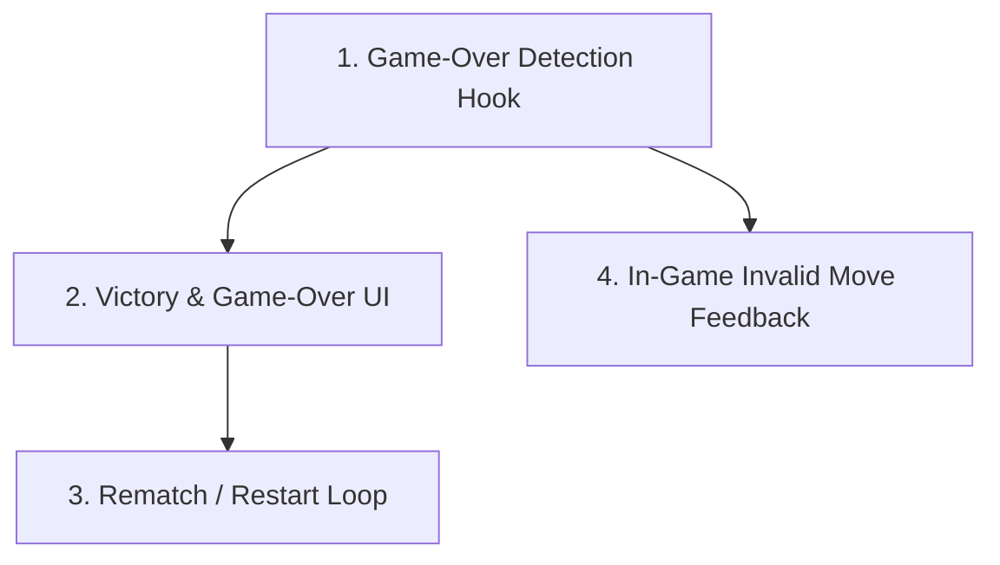

# TacTile — Development Roadmap

This document outlines the development trajectory for **TacTile**, organized into two distinct phases in accordance with the project rules:
- **Phase 1: University Project Deliverables** (Primary focus: stability, completing required core gameplay loops, minimal risk).
- **Phase 2: Standalone Mobile Expansion** (Long-term vision: touch controls, UI responsiveness, mobile optimization, and AI opponents).

---

## 1. Phase 1: Remaining Work for University Deliverable

The immediate goal is to complete the core gameplay loop so that a full match can be played from start to finish with an announced winner and the option to replay.



### 1.1 Game-Over State Detection (Required)
- **Problem:** [GameState.cs#L57-L65](file:///C:/Users/oldha/OneDrive/Documents/CST-410/TacTile/Assets/Scripts/Game/GameState.cs#L57-L65) defines `IsGameOver`, but it is never checked by [GameDriver.cs](file:///C:/Users/oldha/OneDrive/Documents/CST-410/TacTile/Assets/Scripts/Game/GameDriver.cs). When all 25 spaces are filled, the game halts with `(No legal actions available.)`.
- **Proposed Solution:** In `GameDriver.AdvanceAutomaticPhases()` or following `ResolveCaptures()`, check `state.IsGameOver`. If true, transition to a new `TurnPhase.GameOver` or trigger a game-over handler.
- **Dependencies:** None.

### 1.2 Victory & Results UI (Required)
- **Problem:** There is currently no UI panel to inform players who won, what the final scores are, or whether a tie occurred.
- **Proposed Solution:**
  - Create a lightweight `GameOverPanel` UI under the existing `Canvas`.
  - Display the winner ("Player 1 Wins!", "Player 2 Wins!", or "Draw!").
  - Present final placed tile counts for each player.
- **Dependencies:** Requires Section 1.1.

### 1.3 Rematch / Restart Functionality (Required)
- **Problem:** Players currently have to stop and restart the Unity Editor Play mode to play another match.
- **Proposed Solution:**
  - Add a "Play Again" / "Rematch" button to the `GameOverPanel`.
  - Connect button to reload the scene (`SceneManager.LoadScene(SceneManager.GetActiveScene().buildIndex)`) or reset the `GameState` and re-generate the board/tiles cleanly.
- **Dependencies:** Requires Section 1.2.

### 1.4 In-Game Invalid Action Feedback (Recommended for Usability)
- **Problem:** When an invalid tile is selected or an occupied square is clicked, the rejection is only logged in the Unity debug console.
- **Proposed Solution:** Display a brief visual toast or color flash (e.g., flashing the board space red or subtle shake) to communicate invalid inputs directly to players.
- **Dependencies:** None (independent).

---

## 2. Known Bugs and Fragile Implementation Concerns

| Issue | Severity | Location | Description & Proposed Fix |
| :--- | :--- | :--- | :--- |
| **Startup Order Coupling** | Moderate | [GameDriver.cs#L5](file:///C:/Users/oldha/OneDrive/Documents/CST-410/TacTile/Assets/Scripts/Game/GameDriver.cs#L5) | `GameDriver` relies on `[DefaultExecutionOrder(1000)]` and `FindObjectsOfType` to discover board spaces and tiles. If instantiation is delayed or objects are spawned asynchronously, initialization fails. **Fix:** Pass created objects directly from generators to `GameDriver` or instantiate via a centralized bootstrap. |
| **Null Driver Reference in Spawner** | Moderate | [TileSpawner.cs#L95](file:///C:/Users/oldha/OneDrive/Documents/CST-410/TacTile/Assets/Scripts/Tile/TileSpawner.cs#L95) | `TileSpawner` calls `tileView.Initialize(owner, null)`. Until `GameDriver` starts, `tileView.gameDriver` is `null`. A click during frame 0 could throw a `NullReferenceException`. **Fix:** Initialize `gameDriver` via `GameDriver.Instance` or pass the instance directly. |
| **Redundant Balance Config References** | Low | Scene GameObjects | `balanceConfig` is referenced in three separate places (`GameManager`, `Board`, `TileManager`). Swapping or changing one asset reference risks desynchronizing game settings. **Fix:** Access `balanceConfig` through `GameDriver.Instance.BalanceConfig` or a single authoritative manager. |
| **Prefab Color Overrides** | Low | [BoardSquare.prefab](file:///C:/Users/oldha/OneDrive/Documents/CST-410/TacTile/Assets/Prefabs/BoardSquare.prefab), [Tick.prefab](file:///C:/Users/oldha/OneDrive/Documents/CST-410/TacTile/Assets/Prefabs/Tick.prefab) | Serialized YAML fields override C# default colors (lime-green yellow, dark-blue light-blue). **Fix:** Align serialized prefab colors with standardized design palette. |
| **Per-Frame Scoreboard Polling** | Low | [ScoreboardUI.cs#L32](file:///C:/Users/oldha/OneDrive/Documents/CST-410/TacTile/Assets/Scripts/Game/ScoreboardUI.cs#L32) | `ScoreboardUI.Update()` loops over all 26 tiles every single frame. While CPU impact is low for 26 objects, event-driven updates are much cleaner. **Fix:** Subscribe to an `OnTilePlaced` / `OnOwnershipChanged` event. |

---

## 3. Potential Quality-of-Life Improvements (Phase 1 Non-Breaking)

These improvements enhance gameplay polish without altering fundamental rules or risking deliverables:
1. **Valid Placement Space Highlighting:** When a tile is selected, subtly tint or highlight the empty board spaces where the tile can be placed.
2. **Combat Visual Feedback:** Display brief battle popups or floating numbers comparing edge strengths during captures.
3. **Audio Effects:** Add sound effects for tile selection wobble, board placement snap, capture flip, and victory fanfare (using placeholder audio in [Assets/Audio](file:///C:/Users/oldha/OneDrive/Documents/CST-410/TacTile/Assets/Audio)).
4. **Tile Selection Deselect:** Allow clicking a selected tile a second time to deselect it and cancel the wobble animation.

---

## 4. Phase 2: Standalone Mobile Expansion

These tasks are deferred until after the university project is finalized and accepted. They prepare TacTile for commercial release on iOS and Android.

### 4.1 Touch Controls and Gesture Handling
- Migrate from legacy `OnMouseDown()` on 3D BoxColliders to Unity's New Input System (`com.unity.inputsystem` v1.19.0).
- Support single-tap selection, touch drag-and-drop tile placement, and touch cancellation when dragging outside valid drop targets.
- Disable multi-touch during placements to avoid simultaneous conflicting inputs.

### 4.2 Responsive UI and Aspect Ratio Adaptation
- Change [CanvasScaler](file:///C:/Users/oldha/OneDrive/Documents/CST-410/TacTile/Assets/Scenes/MainScene.unity#L1191453415) from `ConstantPixelSize` (`m_UiScaleMode: 0`) to `ScaleWithScreenSize` (`m_UiScaleMode: 1`) with a reference resolution ($1080 \times 1920$ portrait or $1920 \times 1080$ landscape).
- Anchor scoreboard and buttons using relative anchor presets so they adapt across phone screens (16:9, 19.5:9, 21:9) and tablets (4:3, 16:10).
- Implement Safe Area management for device notches, camera punch-holes, and home indicator bars.
- Add camera viewport fitting (orthographic camera or dynamic perspective FOV calculator) so tile racks at $Z = \pm 7.3$ are never clipped regardless of aspect ratio.

### 4.3 Mobile Performance & Rendering Optimization
- **Tick Mesh Consolidation:** Currently, each tick is an individual instantiated GameObject (~200+ GameObjects). Combine tick geometry dynamically into the tile mesh, use GPU instancing on the tick material, or represent tick marks via custom shaders/textures to minimize draw calls and battery drain.
- Switch active URP pipeline asset to [Mobile_RPAsset.asset](file:///C:/Users/oldha/OneDrive/Documents/CST-410/TacTile/Assets/Settings/Mobile_RPAsset.asset) and [Mobile_Renderer.asset](file:///C:/Users/oldha/OneDrive/Documents/CST-410/TacTile/Assets/Settings/Mobile_Renderer.asset) for mobile build configurations.

### 4.4 Single-Player AI Opponent
- Implement a computer opponent (Pass-and-Play vs. AI mode).
- Develop difficulty tiers:
  - **Easy:** Random legal placement from available tiles.
  - **Medium:** Greedy heuristic maximizing immediate captures and boost space acquisition.
  - **Hard:** Minimax with Alpha-Beta pruning (depth 2–3) considering tile conservation and corner defense.

---

## 5. Suggested Implementation Order & Dependency Matrix

```
┌────────────────────────────────────────────────────────┐
│ Phase 1: University Deliverables                       │
├────────────────────────────────────────────────────────┤
│ Step 1: Game-Over Detection Hook (GameDriver)          │
│         │                                              │
│         ▼                                              │
│ Step 2: Victory & Game-Over Canvas UI                  │
│         │                                              │
│         ▼                                              │
│ Step 3: Rematch / Play Again Button Logic              │
│                                                        │
│ Step 4: Invalid Move Feedback & Deselection (QoL)      │
└────────────────────────────────────────────────────────┘
                           │
                           ▼
┌────────────────────────────────────────────────────────┐
│ Phase 2: Standalone Mobile Expansion                   │
├────────────────────────────────────────────────────────┤
│ Step 5: Canvas Scaler & Responsive Screen Layout       │
│ Step 6: Camera Aspect Ratio Fitter                     │
│ Step 7: New Input System Touch Adapter                 │
│ Step 8: Tick Mesh / Shader Optimization                │
│ Step 9: Computer Opponent (AI) Implementation          │
└────────────────────────────────────────────────────────┘
```
