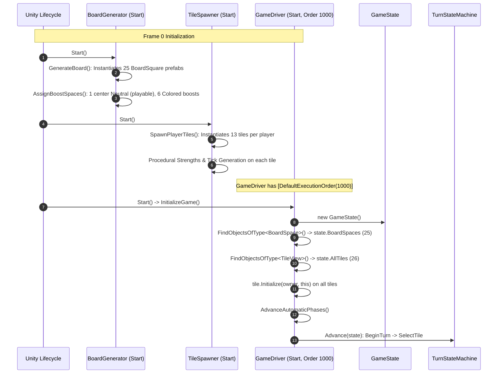

# TacTile — Technical Architecture

## 1. Engine and Environment Specifications

- **Unity Editor Version:** `6000.3.11f1` (Unity 6.3 preview/release), verified in [ProjectSettings/ProjectVersion.txt](file:///C:/Users/oldha/OneDrive/Documents/CST-410/TacTile/ProjectSettings/ProjectVersion.txt).
- **Target OS:** Windows 11 (Development); standalone PC build target with mobile expansion planned for Phase 2.
- **Rendering Pipeline:** Universal Render Pipeline (URP 17.3.0), utilizing [PC_RPAsset.asset](file:///C:/Users/oldha/OneDrive/Documents/CST-410/TacTile/Assets/Settings/PC_RPAsset.asset) and [PC_Renderer.asset](file:///C:/Users/oldha/OneDrive/Documents/CST-410/TacTile/Assets/Settings/PC_Renderer.asset).
- **Input System:** Both legacy Input Manager and the New Input System are enabled (`activeInputHandler: 2` in [ProjectSettings/ProjectSettings.asset](file:///C:/Users/oldha/OneDrive/Documents/CST-410/TacTile/ProjectSettings/ProjectSettings.asset)), package `com.unity.inputsystem` v1.19.0.
- **UI Framework:** Unity UI (uGUI v2.0.0) combined with TextMeshPro.
- **Active Git Branch:** `ai-development`.

---

## 2. Project Directory Structure

```
Assets/
├── Materials/            # Surface materials (BoardLight, TileColorOne, TickDark, BackGround)
├── Prefabs/              # Core runtime prefabs (BoardSquare, Tile, Tick)
├── Scenes/
│   ├── MainScene.unity   # Primary gameplay scene (Build Index 0, active)
│   └── SampleScene.unity # Inactive template scene
├── Settings/             # URP configuration assets and volume profiles
├── TextMesh Pro/         # TMP fonts and default resources
├── Scripts/
│   ├── Board/
│   │   ├── BoardGenerator.cs  # 5x5 board instantiation and boost assignment
│   │   └── BoardSpace.cs      # Board cell logic, position tracking, placement receiver
│   ├── Config/
│   │   ├── GameBalanceConfig.cs     # ScriptableObject definition for game constants
│   │   └── GameBalanceConfig.asset  # Serialized asset holding active balance values
│   ├── Game/
│   │   ├── GameDriver.cs         # Main orchestrator, singleton, combat and turn loop
│   │   ├── GameState.cs          # Domain data model for board, tiles, and player state
│   │   ├── TurnStateMachine.cs   # Static phase transition state machine
│   │   ├── LegalMoveGenerator.cs # Static query engine determining legal actions
│   │   ├── ScoreboardUI.cs       # UI script tracking scores and highlighting active player
│   │   └── ClickTester.cs        # Debug raycasting script attached to Main Camera
│   ├── Tile/
│   │   ├── TileSpawner.cs        # Player rack tile instantiation and color balancing
│   │   ├── TileGenerator.cs      # Procedural edge strength generator and tick instantiator
│   │   ├── TileView.cs           # Tile presentation, selection wobble, placement state
│   │   └── TickView.cs           # Individual tick renderer and color application
│   └── Unused/                   # Deprecated prototypes (Board.cs, Space.cs, TileData.cs)
└── _Recovery/            # Auto-saved recovery scene (0.unity) from prior editor session
```

---

## 3. Important Scripts, Classes, and Responsibilities

This table clearly distinguishes between **currently implemented functionality** and **planned architecture** for upcoming required deliverables:

| Class / File | Status | Architectural Role | Current & Planned Responsibilities |
| :--- | :--- | :--- | :--- |
| [GameDriver.cs](file:///C:/Users/oldha/OneDrive/Documents/CST-410/TacTile/Assets/Scripts/Game/GameDriver.cs) | Implemented | Singleton Controller | Central coordinator with `[DefaultExecutionOrder(1000)]`. Populates `GameState`, handles tile selection, coordinates placement, executes combat calculations, and drives turn phases. *Planned:* Evaluate `state.IsGameOver` to invoke victory flow. |
| [GameState.cs](file:///C:/Users/oldha/OneDrive/Documents/CST-410/TacTile/Assets/Scripts/Game/GameState.cs) | Implemented | Domain Model | Holds runtime game state: `CurrentPlayer`, `CurrentPhase`, `SelectedTile`, `BoardSpaces`, `AllTiles`, and `CompletedTurns`. Provides helper queries (`GetPlayerTiles`, `GetEmptySpaces`, `IsGameOver`). |
| [TurnStateMachine.cs](file:///C:/Users/oldha/OneDrive/Documents/CST-410/TacTile/Assets/Scripts/Game/TurnStateMachine.cs) | Implemented | State Machine Logic | Controls valid transitions: `BeginTurn` $\to$ `SelectTile` $\to$ `PlaceTile` $\to$ `EndTurn` $\to$ `BeginTurn`. Toggles active player and increments completed turn counter. *Planned:* Add terminal `GameOver` phase. |
| [LegalMoveGenerator.cs](file:///C:/Users/oldha/OneDrive/Documents/CST-410/TacTile/Assets/Scripts/Game/LegalMoveGenerator.cs) | Implemented | Rule Engine | Computes legal moves for a given player based on turn phase, returning a `List<LegalAction>`. |
| [BoardGenerator.cs](file:///C:/Users/oldha/OneDrive/Documents/CST-410/TacTile/Assets/Scripts/Board/BoardGenerator.cs) | Implemented | World Builder | Instantiates the board grid at `Start()`, calculates centered world coordinates, and distributes 1 neutral and 6 colored boost spaces based on config. |
| [BoardSpace.cs](file:///C:/Users/oldha/OneDrive/Documents/CST-410/TacTile/Assets/Scripts/Board/BoardSpace.cs) | Implemented | View / Component | Sits on each cell prefab. Stores `Row`, `Column`, `OccupyingTile`, `BoostType`. Listens for clicks via `OnMouseDown()`, notifies `GameDriver`, and handles tile reparenting upon placement. |
| [TileSpawner.cs](file:///C:/Users/oldha/OneDrive/Documents/CST-410/TacTile/Assets/Scripts/Tile/TileSpawner.cs) | Implemented | Spawner | Spawns tiles for each player at `Start()`. Ensures balanced tick colors across each player's rack based on config. |
| [TileGenerator.cs](file:///C:/Users/oldha/OneDrive/Documents/CST-410/TacTile/Assets/Scripts/Tile/TileGenerator.cs) | Implemented | Procedural Generator | Generates random edge strengths ($0-4$) summing to $7-9$ total ticks. Instantiates `Tick.prefab` objects around tile edges. *Planned:* Maximum-attempt loop safeguard to prevent freezes. |
| [TileView.cs](file:///C:/Users/oldha/OneDrive/Documents/CST-410/TacTile/Assets/Scripts/Tile/TileView.cs) | Implemented | View / Component | Manages visual representation (white for P1, black for P2), tracks placement status, runs selection wobble coroutine (`Jiggle()`), and listens for clicks via `OnMouseDown()`. *Planned:* Visual boost indicator controller. |
| [TickView.cs](file:///C:/Users/oldha/OneDrive/Documents/CST-410/TacTile/Assets/Scripts/Tile/TickView.cs) | Implemented | View / Component | Colors individual tick meshes using `MaterialPropertyBlock` for `Red`, `LightBlue`, or `Yellow`. *Planned:* Glow/luminance effect when tile is boosted. |
| [ScoreboardUI.cs](file:///C:/Users/oldha/OneDrive/Documents/CST-410/TacTile/Assets/Scripts/Game/ScoreboardUI.cs) | Implemented | View / UI Controller | Polls placed tile ownership each frame in `Update()`, updates TMP score text, and highlights the active player's name. |
| [GameBalanceConfig.cs](file:///C:/Users/oldha/OneDrive/Documents/CST-410/TacTile/Assets/Scripts/Config/GameBalanceConfig.cs) | Implemented | ScriptableObject Schema | Defines all 9 game balance variables. *Planned:* Runtime in-memory cloning architecture for UI-driven customization. |
| `MainMenuUI` | Planned | UI Navigation Controller | Manages Main Menu navigation across **Play**, **Settings**, and **Rules** views. |
| `VictoryScreenUI` | Planned | UI Overlay Controller | Displays winner announcement, match summary, "Play Again" (match restart), and "Return to Menu". |
| `SettingsUI` | Planned | UI Settings Controller | Exposes all 9 balance variables in UI, performs joint tick validation, displays error feedback, and handles "Reset to Defaults". |

---

## 4. Game Balance Configuration & Runtime Architecture

### The 9 Balance Variables in [GameBalanceConfig.cs](file:///C:/Users/oldha/OneDrive/Documents/CST-410/TacTile/Assets/Scripts/Config/GameBalanceConfig.cs)

All 9 variables present in source code must be exposed in the planned Settings UI:

| Category | Variable Name | Type | Default Value | Gameplay Role & Reinitialization Scope |
| :--- | :--- | :--- | :--- | :--- |
| **Board** | `boardSize` | `int` | `5` (Min: 3) | Defines row and column dimensions ($N \times N$). **Requires complete board regeneration.** Cannot apply mid-match. |
| **Board** | `boostsPerColor` | `int` | `2` (Min: 0) | Number of boost spaces per color (Red, LightBlue, Yellow). **Requires complete board regeneration.** |
| **Player** | `tilesPerPlayer` | `int` | `13` (Min: 1) | Number of tiles generated in each player's rack. **Requires complete tile rack regeneration.** |
| **Tile Strength** | `minimumSideStrength` | `int` | `0` (Min: 0) | Lower bound on each of the 4 individual edge strengths. **Requires tile rack regeneration.** |
| **Tile Strength** | `maximumSideStrength` | `int` | `4` (Min: 0) | Upper bound on each of the 4 individual edge strengths. **Requires tile rack regeneration.** |
| **Tile Strength** | `minimumTotalTicks` | `int` | `7` (Min: 0) | Lower bound on the 4-edge tick sum. **Requires tile rack regeneration.** |
| **Tile Strength** | `maximumTotalTicks` | `int` | `9` (Min: 0) | Upper bound on the 4-edge tick sum. **Requires tile rack regeneration.** |
| **Boost Bonus** | `neutralBoostBonus` | `int` | `1` (Min: 0) | Numerical strength bonus granted by the neutral center space. Evaluated during combat calculations. |
| **Boost Bonus** | `matchingColorBoostBonus`| `int` | `1` (Min: 0) | Numerical strength bonus granted by matching-color boost spaces. Evaluated during combat calculations. |

### Configuration Lifecycle: Default Asset vs. Runtime In-Memory Copy
1. **Immutable Project Asset:** The serialized asset [GameBalanceConfig.asset](file:///C:/Users/oldha/OneDrive/Documents/CST-410/TacTile/Assets/Scripts/Config/GameBalanceConfig.asset) stored in `Assets/Scripts/Config/` represents the **immutable factory defaults**. It must never be written to or mutated at runtime to avoid dirtying project assets.
2. **Runtime In-Memory Copy:** When the application starts, it creates a runtime clone of the configuration in memory (e.g., via `ScriptableObject.Instantiate(defaultConfig)`). All modifications made via the Settings UI operate strictly on this runtime instance.
3. **Session Persistence:** Changes made in the Settings UI persist across matches during the current application session. When a new application session begins (restarting the game), the configuration reverts to the Inspector defaults. The UI also provides a dedicated "Reset to Defaults" button to restore factory settings on demand.
4. **Reinitialization Boundary:** Any changes to variables marked *Requires match regeneration* must only take effect when starting a new match (or by clicking "Play Again" / "Start Game"). Applying structural settings mid-turn is prohibited to prevent desynchronization.

---

## 5. Tick Configuration Validation & Stability Safeguards

### Vulnerability Analysis in [TileGenerator.cs](file:///C:/Users/oldha/OneDrive/Documents/CST-410/TacTile/Assets/Scripts/Tile/TileGenerator.cs#L41-L77)
Currently, `TileGenerator.RandomizeStrengths()` rolls 4 edge strengths uniformly from $[S_{\min}, S_{\max}]$ inside a `do-while` loop until their sum falls within $[T_{\min}, T_{\max}]$:
```csharp
do
{
    topStrength = Random.Range(balanceConfig.minimumSideStrength, balanceConfig.maximumSideStrength + 1);
    rightStrength = Random.Range(balanceConfig.minimumSideStrength, balanceConfig.maximumSideStrength + 1);
    bottomStrength = Random.Range(balanceConfig.minimumSideStrength, balanceConfig.maximumSideStrength + 1);
    leftStrength = Random.Range(balanceConfig.minimumSideStrength, balanceConfig.maximumSideStrength + 1);
    totalTicks = topStrength + rightStrength + bottomStrength + leftStrength;
}
while (totalTicks < balanceConfig.minimumTotalTicks || totalTicks > balanceConfig.maximumTotalTicks);
```

### Mathematical Feasibility Requirements
Assuming all 4 sides are generated independently over $[S_{\min}, S_{\max}]$, the achievable sum of 4 sides spans $[4 \times S_{\min}, 4 \times S_{\max}]$.
For the generation loop to be capable of terminating, this achievable range must intersect the configured tick limits $[T_{\min}, T_{\max}]$:
1. $S_{\min} \le S_{\max}$
2. $T_{\min} \le T_{\max}$
3. $4 \times S_{\min} \le T_{\max}$ (the minimum possible 4-side sum cannot exceed the allowed maximum total).
4. $4 \times S_{\max} \ge T_{\min}$ (the maximum possible 4-side sum must reach at least the allowed minimum total).

### Distinction: Mathematical Feasibility vs. Full Range Reachability
*Critical Distinction:* While the intersection $[4 \times S_{\min}, 4 \times S_{\max}] \cap [T_{\min}, T_{\max}] \neq \emptyset$ guarantees that *at least one* valid sum exists (preventing an infinite loop), it does **not** guarantee that *every* integer in $[T_{\min}, T_{\max}]$ can be formed.
- *Example:* If $S_{\min} = 1, S_{\max} = 2$, achievable sums are strictly $[4..8]$. If a user configures $[T_{\min}=4, T_{\max}=10]$, the loop terminates normally because $[4..8]$ is accepted, but totals $9$ and $10$ will never be generated. The validation logic must document this behavior and ensure users are informed if parts of their configured range are mathematically unreachable.

### Board Space Constraint
In addition to tick math, the board must physically accommodate the requested boost spaces:
$$3 \times \text{boostsPerColor} \le \text{boardSize}^2 - 1 \quad (\text{with } \text{boardSize} \ge 3)$$

### UI Rejection & Hard Code Safeguard
1. **UI Validation Behavior:** The Settings UI must evaluate all constraints jointly before applying changes. If an invalid or conflicting combination is entered, the UI must **reject the submission and display a clear, human-readable explanation** describing the exact conflict (e.g., *"Minimum side strength of 3 requires at least 12 total ticks, which exceeds the maximum total of 9"*). The system must **not** silently clamp or modify other settings without user consent.
2. **Hard Code Safeguard (Loop Break):** To ensure stability even against unexpected edge cases, the eventual implementation of `TileGenerator.RandomizeStrengths()` must include a maximum iteration counter:
   ```csharp
   const int maxAttempts = 500;
   int attempts = 0;
   do {
       // roll strengths...
       attempts++;
       if (attempts >= maxAttempts) {
           Debug.LogError("TileGenerator: Exceeded maximum attempts. Falling back to deterministic safe tile.");
           // Apply safe fallback values satisfying constraints
           break;
       }
   } while (...);
   ```

---

## 6. Game Initialization Sequence



---

## 7. Scene Objects, Canvas Structure, and Planned UI Hierarchy

Current hierarchy in [MainScene.unity](file:///C:/Users/oldha/OneDrive/Documents/CST-410/TacTile/Assets/Scenes/MainScene.unity) alongside planned UI additions:

```
Hierarchy
├── Main Camera (Transform, Camera, AudioListener, URP Additional Camera Data, ClickTester)
├── Directional Light (Transform, Light, URP Additional Light Data)
├── Global Volume (Transform, Volume with DefaultVolumeProfile)
├── BoardBase (Transform, BoxCollider)
├── Board (Transform, BoardGenerator)
│   ├── boardSquarePrefab -> Assets/Prefabs/BoardSquare.prefab
│   ├── balanceConfig     -> Runtime Balance Instance (cloned from GameBalanceConfig.asset)
│   └── squareSpacing     -> 2.0
├── TileManager (Transform, TileSpawner)
│   ├── tilePrefab        -> Assets/Prefabs/Tile.prefab
│   ├── balanceConfig     -> Runtime Balance Instance
│   ├── tileSpacing       -> 2.25
│   ├── playerOneZ        -> -7.3
│   └── playerTwoZ        -> 7.3
├── GameManager (Transform, GameDriver)
│   └── balanceConfig     -> Runtime Balance Instance
└── Canvas (RectTransform, Canvas, CanvasScaler, GraphicRaycaster)
    ├── ScoreboardPanel [Implemented] (ScoreboardUI)
    │   ├── player1NameText, player1ScoreText
    │   └── player2NameText, player2ScoreText
    ├── MainMenuPanel [Planned] (MainMenuUI)
    │   ├── PlayButton (starts match)
    │   ├── SettingsButton (opens SettingsPanel)
    │   └── RulesButton (opens RulesPanel)
    ├── RulesPanel [Planned]
    │   ├── RulesContentText (guide to grid, tiles, combat, boosts)
    │   └── CloseRulesButton
    ├── SettingsPanel [Planned] (SettingsUI)
    │   ├── Sliders / Input Fields for all 9 balance variables
    │   ├── ValidationErrorMessageText
    │   ├── ApplyButton
    │   ├── ResetToDefaultsButton
    │   └── BackButton
    └── VictoryScreenPanel [Planned] (VictoryScreenUI)
        ├── WinnerAnnouncementText ("Player 1 Wins!" / "Player 2 Wins!" / "Draw!")
        ├── FinalScoreSummaryText
        ├── PlayAgainButton (triggers match restart)
        └── ReturnToMenuButton (returns to MainMenuPanel)
```

---

## 8. Verified Facts vs. Assumptions

### Verified Implementation Facts
1. **No Standalone CombatManager or TurnManager:** Combat logic resides entirely in `GameDriver.cs`. Turn logic is split between static `TurnStateMachine.cs` and `GameDriver.cs`.
2. **Missing Victory Loop:** `GameState.cs` contains an `IsGameOver` property (lines 57–65), but it is never invoked or referenced anywhere else in the project. The game has no game-over screen or restart mechanic.
3. **Intentional Tile Count:** Each player receives 13 tiles. The board contains 25 playable spaces, including the center neutral purple boost space. Therefore, when the board is full, exactly one tile remains unused overall. Which player retains that tile depends on placement order.
4. **Input Architecture:** Uses legacy `OnMouseDown()` on 3D physics BoxColliders. It does not use the New Input System actions despite the package being installed.
5. **Scoreboard Polling:** `ScoreboardUI.Update()` counts placed tiles every frame via a `foreach` loop over `state.AllTiles`.
6. **Tick Generation Freeze Risk:** `TileGenerator.RandomizeStrengths()` uses an unguarded `do-while` loop that will freeze the Unity thread if impossible constraints are provided.

### Assumptions (Identified for Verification)
1. **Input Touch Behavior on Mobile:** Unity emulates mouse clicks from single touches on mobile devices, which allows basic `OnMouseDown()` taps to work in standard scenarios. However, this has not been validated on a physical device build and lacks multi-touch or touch-cancellation handling.
2. **Color Palette Mismatch in Prefabs:** In [BoardSquare.prefab](file:///C:/Users/oldha\OneDrive\Documents\CST-410\TacTile\Assets\Prefabs\BoardSquare.prefab#L130-L131) and [Tick.prefab](file:///C:/Users/oldha\OneDrive\Documents\CST-410\TacTile\Assets\Prefabs\Tick.prefab#L130-L131), `yellowColor` is serialized as lime green (`0.196, 0.804, 0.196`) and `lightBlueColor` as pure blue (`0, 0, 1`). It is assumed this was an intentional visual choice in the Unity Inspector that overrides the C# default constants.
